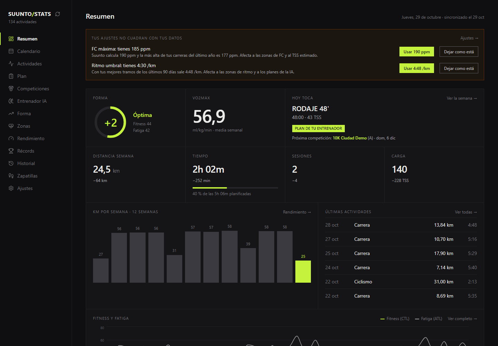
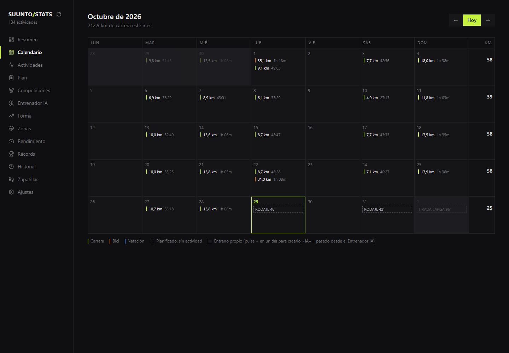
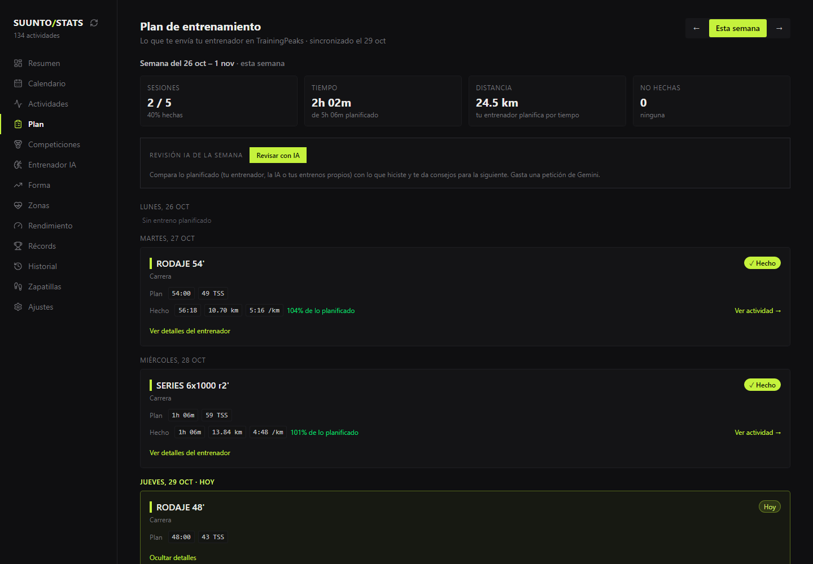
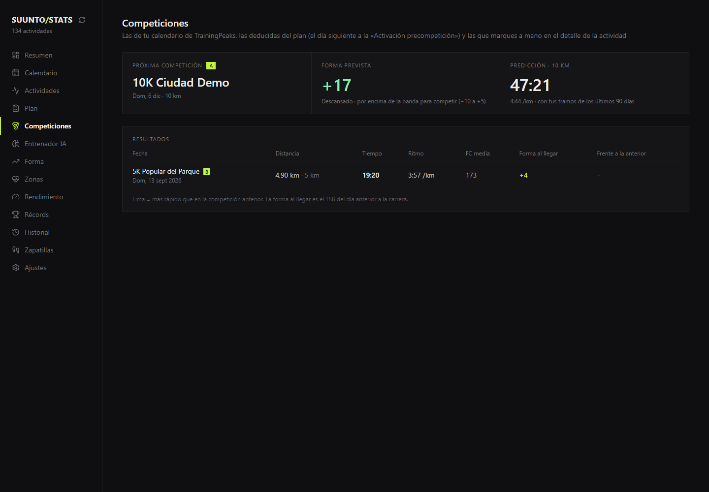

# Suunto Stats

[English](README.md) · **Español**

**Suunto Stats** es un panel de entrenamiento gratuito y de código abierto para corredores con reloj Suunto. Descarga tus entrenamientos a tu propio ordenador y te muestra tu forma física y la **forma prevista** para las próximas semanas, tus zonas de pulso y de ritmo (con el reparto 80/20), tus **récords** con **predicción de tiempos de carrera**, tus competiciones, el historial por años, los mapas de cada salida coloreados por ritmo y los km de tus **zapatillas**. Con el **calendario** ves en un mes lo que hiciste y lo que tienes planificado, y puedes añadir tus propios entrenos. Si tienes entrenador, añade su **plan de TrainingPeaks** (opcional) junto a lo que hiciste de verdad. Además, un **entrenador IA** (Gemini, Claude, OpenAI o un modelo local) crea **planificaciones semanales**, al estilo de tu entrenador o sin entrenador para un 5k, 10k, media o maratón, las pasa al calendario y revisa cómo te ha ido cada semana. Funciona con tu cuenta de Suunto o con ficheros FIT. Sin nube y sin base de datos: tus datos se quedan contigo, salvo los resúmenes que tú decidas mandar a la IA. Y si quieres usarla desde cualquier sitio, puedes publicarla en tu dominio con contraseña y código ([guía de despliegue](GUIA_DESPLIEGUE.md)).



> Las capturas son de la **demo**, con datos inventados: puedes verla tú sin cuenta de Suunto (ver [Probar la demo](#probar-la-demo-sin-cuenta)).

---

## Qué hace la app

| Sección | Qué verás |
| --- | --- |
| **Resumen** | Forma de hoy, VO2max, «Hoy toca», semana en curso, km por semana, últimas actividades y avisos (ajustes desfasados, zapatillas gastadas) |
| **Calendario** | Mes con lo que hiciste, lo planificado y las competiciones; crea, edita y borra tus propios entrenos (en el móvil, en forma de agenda) |
| **Actividades** y **Detalle** | Lista con filtros; en cada actividad, mapa coloreado por ritmo, parciales, zonas, mejores tramos y las zapatillas que usaste |
| **Plan** | El plan de tu entrenador en TrainingPeaks (opcional) con lo hecho y lo pendiente, y la **revisión de la semana con IA** |
| **Competiciones** | Tus carreras, la forma con la que llegaste y la predicción para la próxima |
| **Entrenador IA** | Con Gemini (gratis, opcional; o con OpenAI, Mistral, Claude, una IA local con Ollama… ver [Elegir la IA](#elegir-la-ia)): pregúntale por tu entrenamiento y genera semanas **como tu entrenador** o **sin entrenador** para un objetivo (5K, 10K, media, maratón o ninguno); pásalas a tu Calendario |
| **Forma, Zonas, Rendimiento, Récords, Historial** | CTL/ATL/TSB con previsión, 80/20, eficiencia, desacoplamiento, récords con predicción y totales por año |
| **Zapatillas** | Km por par con etiquetas (rodaje, competición…) y aviso al acercarse al límite |
| **Importar FIT** | Sube ficheros `.fit` desde el navegador (arrastrándolos); con cuenta de Suunto se suman a ella sin repetir sesiones |
| **Ajustes** | Umbrales, avisos para la IA y **copia de seguridad** de lo que guardas en el navegador |

| Calendario | Plan | Competiciones |
| --- | --- | --- |
|  |  |  |

---

## Probar la demo (sin cuenta)

Con Node.js instalado (ver [Qué necesitas](#qué-necesitas)), desde la carpeta del proyecto:

```bash
npm install
npm run demo
```

Abre el enlace que aparece. Usa los datos inventados de `demo/data/` (un corredor ficticio, su plan y dos carreras) y nunca toca los tuyos. Para que las fechas lleguen hasta hoy: `python3 fetch/make_demo.py` (en Windows, `py fetch\make_demo.py`).

---

## Dos formas de traer tus datos

| | **Ruta A — Automática** | **Ruta B — Ficheros FIT** |
| --- | --- | --- |
| Cómo funciona | Lee tu cuenta de Suunto (la misma de la app del móvil) | Exportas tus entrenamientos como `.fit` desde la app y los copias a una carpeta |
| Comodidad | Un solo comando, descarga todo el historial | Hay que exportar los entrenamientos de uno en uno |
| Riesgo | **No es oficial**: Suunto no ofrece API para uso personal. Puede dejar de funcionar sin aviso y podría ir contra sus términos de uso | Ninguno: son tus propios ficheros |
| Necesitas | La herramienta `suuntool` (solo para iniciar sesión) | Nada más |

Elige una. Si cambias de una a otra, la lista de actividades se rehace con la fuente nueva (no se mezclan). El resto de la app es idéntico.

Primero haz la **preparación común** y después sigue solo la sección de tu ruta: [Ruta A](#ruta-a--automática-cuenta-de-suunto) o [Ruta B](#ruta-b--ficheros-fit).

---

## Preparación común (las dos rutas)

### Qué necesitas

| Programa | Para qué sirve | Cómo comprobarlo |
| --- | --- | --- |
| **Node.js** (v18 o superior) | Ejecutar la app web | `node --version` |
| **Python** (v3.10 o superior) | Descargar y preparar los datos | `python3 --version` |

> **¿No tienes Node.js o Python?**
>
> - Node.js: [https://nodejs.org](https://nodejs.org) → descarga la versión LTS.
> - Python: [https://python.org/downloads](https://python.org/downloads) → en Mac/Linux suele venir instalado.
>
> **En Windows**, donde pone `python3` usa `py`. Si PowerShell dice que la ejecución de scripts está deshabilitada (le pasa a `npm` y al entorno virtual), ejecuta una vez: `Set-ExecutionPolicy -Scope CurrentUser RemoteSigned`.

### 1. Descargar el proyecto

Abre la carpeta del proyecto en la terminal:

```bash
cd ruta/donde/está/suunto-stats
```

### 2. Instalar dependencias de Python

Desde la carpeta raíz del proyecto:

```bash
python3 -m pip install -r fetch/requirements.txt
```

> **Si `pip` dice «externally-managed-environment»** (pasa en Ubuntu/WSL y otras distribuciones recientes), crea un entorno virtual en la carpeta del proyecto y úsalo en todos los comandos de Python:
>
> ```bash
> sudo apt install python3-venv          # solo en Debian/Ubuntu, si falta
> python3 -m venv .venv
> source .venv/bin/activate              # Windows (PowerShell): .venv\Scripts\Activate.ps1
> python3 -m pip install -r fetch/requirements.txt
> ```
>
> Cada vez que abras una terminal nueva, ejecuta `source .venv/bin/activate` antes de `python3 fetch/sync.py`.

### 3. Opciones personales en `.env` (opcional)

Sin `.env` todo funciona con los datos de Suunto. Hace falta para la zona horaria, el plan de TrainingPeaks o el Entrenador IA (Gemini). Copia la plantilla y edita la copia:

```bash
cp .env.example .env                  # Windows (PowerShell): Copy-Item .env.example .env
```

Cada opción está explicada en el propio fichero; quita el `#` de las que uses y pon tus valores. `.env` está en `.gitignore` y **nunca se sube a GitHub**: no pongas claves en `.env.example`.

---

## Ruta A — Automática (cuenta de Suunto)

### A1. Instalar suuntool

Solo sirve para iniciar sesión en Suunto una vez: [github.com/tajchert/suuntool](https://github.com/tajchert/suuntool)

- Mac / Linux con Homebrew: `brew install --cask tajchert/tap/suuntool`
- Con Go instalado: `go install github.com/tajchert/suuntool@latest`
- Windows: no tiene binarios oficiales. Instala [Go](https://go.dev/dl/) (instalador para Windows), abre una PowerShell **nueva** y ejecuta `go install github.com/tajchert/suuntool@latest`. Queda en `%USERPROFILE%\go\bin\suuntool.exe`; añade esa carpeta al PATH o ejecútalo con la ruta completa. Alternativa: WSL (Ubuntu). Usa PowerShell o Windows Terminal (en Git Bash el login puede fallar con «stdin is not a TTY»).

Compruébalo con `suuntool version`.

### A2. Iniciar sesión en Suunto (solo la primera vez)

```bash
suuntool login --email tu@email.com
```

Te pedirá tu contraseña de Suunto (la de la app del móvil). **No se guarda ninguna contraseña en este proyecto**: `suuntool` guarda solo una clave de sesión en `~/.config/suuntool/session.json`.

Comprueba que todo va bien:

```bash
suuntool doctor
```

> `suuntool` solo admite email + contraseña. Si entras en la app de Suunto con Facebook u otro acceso social, crea primero una contraseña de Suunto (en la app: Ajustes → Cuenta → Cambiar contraseña; te llega un enlace por email). No está comprobado que eso baste en cuentas creadas con acceso social; si no funciona, usa la [Ruta B](#ruta-b--ficheros-fit).

### A3. Descargar tus actividades

Desde la carpeta raíz del proyecto (para una primera prueba, solo las 20 últimas):

```bash
python3 fetch/sync.py --limit 20
```

**Qué hace este comando:**

- Lee la lista de tus entrenamientos de Suunto
- Descarga el detalle de cada uno (zonas de FC, parciales, ruta GPS)
- Guarda todo en `public/data/` (archivos JSON)

La primera vez puede tardar **varios minutos** si tienes muchas actividades. Verás el progreso en la terminal.

**Opciones útiles:**

```bash
# Todo el historial
python3 fetch/sync.py

# Solo actividades desde una fecha
python3 fetch/sync.py --since 2024-01-01

# Más rápido, sin ruta GPS ni parciales
python3 fetch/sync.py --no-gpx

# Volver a descargar lo ya guardado
python3 fetch/sync.py --force
```

> **Importante:** vuelve a ejecutar `python3 fetch/sync.py` cuando quieras actualizar los datos con entrenamientos nuevos. Las actividades ya descargadas no se vuelven a pedir a Suunto.
>
> **También ficheros FIT:** los `.fit` que haya en `fetch/fit/` (por ejemplo, de otro reloj o subidos desde **Importar FIT**) se suman a tus actividades de Suunto; las sesiones que ya estén en Suunto se detectan (inicio a menos de 2 min y duración parecida) y no se repiten. Con `--no-fit` no se leen.

### A4. Comprobar que los datos son correctos (opcional)

```bash
python3 fetch/validate_output.py
```

Debe terminar con `0 errores`.

### A5. Instalar dependencias de la app web

En la carpeta raíz del proyecto:

```bash
npm install
```

Solo hace falta hacerlo **una vez** (o cuando cambien las dependencias del proyecto).

### A6. Abrir la app

```bash
npm run dev
```

Verás algo como:

```
  ➜  Local:   http://localhost:5173/
```

Abre ese enlace en el navegador (Chrome, Firefox, Safari…). Para **cerrar** la app, vuelve a la terminal y pulsa `Ctrl + C`.

### Resumen rápido de la Ruta A (cuando ya lo hayas hecho una vez)

```bash
# 1. Sincronizar datos nuevos de Suunto
python3 fetch/sync.py

# 1b. (Opcional) Plan de tu entrenador en TrainingPeaks — ver GUIA_TRAININGPEAKS.md
python3 fetch/tp_sync.py

# 2. Arrancar la app
npm run dev
```

Luego abre [http://localhost:5173](http://localhost:5173) en el navegador.

`.\actualizar.ps1` (Windows) o `./actualizar.sh` (Mac/Linux) hace el paso 1 y el 1b de una vez y valida los datos. Con la app abierta (`npm run dev`) también puedes actualizar con el **botón de recargar** que hay junto a SUUNTO/STATS, arriba en el menú.

---

## Ruta B — Ficheros FIT

### B1. Exportar tus entrenamientos

1. En la app de Suunto (móvil): Calendario → elige el entrenamiento → menú de tres puntos (arriba a la derecha) → **exportar como FIT**. Envíatelo a tu ordenador.
2. Copia los `.fit` a la carpeta `fetch/fit/` (créala si no existe), o súbelos después desde la página **Importar FIT** de la app y pulsa «Procesar».

> **¿Muchos entrenamientos?** Exportarlos de uno en uno es lento. Si vives en la UE, el Reglamento de Datos te da derecho a pedir a Suunto tus datos gratis y en formatos como FIT, GPX o JSON (por la app, Sports Tracker o escribiendo a Suunto; ver su [aviso oficial](https://www.suunto.com/legal-pages/suunto-eu-data-act-notice/)). Este proyecto lee ficheros `.fit`.

### B2. Leer los ficheros

Desde la carpeta raíz del proyecto:

```bash
python3 fetch/sync.py --source fit
```

Opcional: en `.env` puedes poner `MAX_HR=190` (tu FC máxima) para que las zonas de FC se calculen con ella.

### B3. Comprobar que los datos son correctos (opcional)

```bash
python3 fetch/validate_output.py
```

Debe terminar con `0 errores`.

### B4. Instalar dependencias de la app web

En la carpeta raíz del proyecto:

```bash
npm install
```

Solo hace falta hacerlo **una vez** (o cuando cambien las dependencias del proyecto).

### B5. Abrir la app

```bash
npm run dev
```

Abre en el navegador el enlace que aparece (normalmente [http://localhost:5173](http://localhost:5173)). Para **cerrar** la app, vuelve a la terminal y pulsa `Ctrl + C`.

### Resumen rápido de la Ruta B (cuando ya lo hayas hecho una vez)

```bash
# 1. Copia los .fit nuevos a fetch/fit/ y léelos
python3 fetch/sync.py --source fit

# 1b. (Opcional) Plan de tu entrenador en TrainingPeaks — ver GUIA_TRAININGPEAKS.md
python3 fetch/tp_sync.py

# 2. Arrancar la app
npm run dev
```

> El botón de recargar de la app, `.\actualizar.ps1` y `./actualizar.sh` usan la Ruta A (cuenta de Suunto); con ficheros FIT, actualiza con los comandos de arriba.

---

## Ajustes dentro de la app

En el menú lateral, entra en **Ajustes** para configurar:

- FC máxima (al terminar la sincronización se te indica la que tienes en tu reloj Suunto)
- FC y ritmo en umbral (running), con una estimación a partir de tus mejores tramos
- FTP (ciclismo)
- Avisos para el Entrenador IA: «mi pulso de muñeca no es fiable» y «grabo el calentamiento por separado»
- Copia de seguridad: exporta e importa todo lo que la app guarda en tu navegador

Estos valores se guardan en tu navegador y afectan a los cálculos de zonas, TSS y fitness. Si no cuadran con tus datos, el Resumen te lo avisa.

---

## Elegir la IA

El Entrenador IA usa **Gemini** por defecto (`GEMINI_API_KEY` en `.env`; clave gratis de Google AI Studio). Para usar otra, pon `AI_PROVIDER` en `.env` (ejemplos en `.env.example`):

| `AI_PROVIDER` | Sirve para | Qué poner |
| --- | --- | --- |
| `gemini` (por defecto) | Google Gemini | `GEMINI_API_KEY` y, si quieres, `GEMINI_MODEL` |
| `openai` | Cualquier servicio con el formato de OpenAI: OpenAI, Mistral, Groq, DeepSeek, OpenRouter… o una IA en tu ordenador con **Ollama** / **LM Studio** (sin clave; tus datos no salen de tu equipo) | `AI_BASE_URL`, `AI_MODEL` y `AI_API_KEY` (no hace falta con localhost) |
| `anthropic` | Claude | `AI_API_KEY` (de console.anthropic.com) y, si quieres, `AI_MODEL` (por defecto `claude-opus-5-5`) |

Las claves se quedan en el servidor de la app y nunca llegan al navegador. No hace falta reiniciar: la app lee `.env` en cada petición.

---

## Publicarla en tu dominio

Por defecto la app solo se abre en el ordenador donde se ejecuta, sin login. Para abrirla desde cualquier sitio, despliégala en un servidor detrás de [Authelia](https://www.authelia.com) (contraseña + código de una app de autenticación) con `AUTH_MODE=authelia`. Guía paso a paso para Dokploy: [GUIA_DESPLIEGUE.md](GUIA_DESPLIEGUE.md).

## Qué datos de Suunto verás

| Dato | Detalle |
| --- | --- |
| Distancia, duración, desnivel, FC, calorías | Siempre |
| TSS | El que calcula Suunto; si falta, la app lo estima con la FC |
| VO2max | Suunto solo lo calcula en carreras y caminatas, así que habrá pocas mediciones |
| Training Effect | Se muestra el aeróbico (PTE de Suunto, escala 1-5). El anaeróbico no viene en los datos de Suunto |
| Zonas de FC | Las de tu reloj (tiempo real en cada zona) |
| Parciales | Las vueltas de tu reloj; si no hay, se calculan automáticos (cada 1 km, o 5 km en bici) |
| SWOLF / brazadas | No vienen en los datos |

---

## Problemas frecuentes

### "ERROR: No hay sesión de Suunto" (Ruta A)

Aún no has iniciado sesión. Ejecuta `suuntool login --email tu@email.com` y repite la sincronización.

### "Sesión de Suunto no válida o caducada" (Ruta A)

La clave de sesión ya no vale. Repite `suuntool login --email tu@email.com`.

### Pide el login y la contraseña es correcta (Ruta A)

Prueba `suuntool doctor`. Si el login falla pero la contraseña es correcta, es posible que Suunto haya cambiado algo en su app y haga falta actualizar `suuntool` (`brew upgrade --cask suuntool` o `go install github.com/tajchert/suuntool@latest`).

### Faltan actividades, o la ruta / los parciales salen vacíos (Ruta A)

Ejecuta `python3 fetch/sync.py --dump latest`. Guarda en `fetch/debug/` lo que devuelve Suunto para tu último entrenamiento; con eso se puede ver qué campo ha cambiado. Para pedir ayuda comparte **solo** el fichero `*.redacted.json` (sin coordenadas ni usuario): los demás ficheros de esa carpeta contienen tu ruta GPS.

### Las horas salen desplazadas

Pon tu zona horaria en `.env`: `SUUNTO_TIMEZONE=Europe/Madrid`.

### "No hay ficheros .fit" (Ruta B)

Copia tus `.fit` en `fetch/fit/` (Ruta B) o ejecuta la sincronización sin `--source fit` (Ruta A).

### "No se encontró /data/activities.json" en la app

Aún no has sincronizado datos. Ejecuta primero:

```bash
python3 fetch/sync.py
```

### La terminal dice que `node` o `npm` no existen

Instala Node.js desde [nodejs.org](https://nodejs.org) y vuelve a abrir la terminal.

### La sincronización va muy lenta (Ruta A)

Es normal: hay una pausa entre peticiones para no saturar el servidor de Suunto. Para una prueba rápida usa `--limit 20` o `--no-gpx`. Si ves errores 429, sube la pausa con `SUUNTO_PAUSE=1.5` en `.env`.

### Puerto 5173 ya en uso

Cierra otras ventanas de terminal donde tengas `npm run dev` corriendo, o Vite te propondrá otro puerto (por ejemplo 5174).

---

## Comandos extra (opcional)

| Comando | Descripción |
| --- | --- |
| `npm run build` | Genera una versión optimizada en la carpeta `dist/` |
| `npm run preview` | Previsualiza la versión de producción (después de `build`) |
| `npm run lint` | Revisa el código con el linter |
| `npm test` | Pasa los tests (vitest) |
| `npm run demo` | Abre la app con los datos inventados de `demo/data/` |
| `python3 fetch/make_demo.py` | Vuelve a generar la demo con fechas hasta hoy |
| `python3 fetch/validate_output.py` | Comprueba que los datos descargados tienen el formato correcto |

---

## Estructura del proyecto (referencia)

```
suunto-stats/
├── .env                      ← Opciones personales (opcional, no compartir)
├── actualizar.ps1 / .sh      ← Actualiza todo de una vez (Windows / Mac-Linux)
├── demo/data/                ← Datos inventados para `npm run demo`
├── server/                   ← Rutas del servidor de Vite (acceso, IA, botón de recargar, subir FIT)
├── deploy/authelia/          ← Configuración de Authelia para publicarla en un dominio
├── fetch/
│   ├── sync.py               ← Script que descarga los datos
│   ├── suunto_client.py      ← Ruta A: lectura de tu cuenta de Suunto
│   ├── fit_source.py         ← Ruta B: lectura de ficheros FIT
│   ├── normalizer.py         ← Convierte los datos al formato de la app
│   ├── validate_output.py    ← Comprueba el formato de los datos
│   ├── tp_sync.py            ← (Opcional) plan de TrainingPeaks
│   ├── make_demo.py          ← Genera la demo
│   ├── requirements.txt      ← Dependencias de Python
│   └── fit/                  ← (Ruta B) tus ficheros .fit
├── public/data/              ← Datos descargados (JSON)
└── src/                      ← Código de la app web (React)
```

---

## Privacidad y qué NO subir a GitHub

Estos archivos contienen datos personales o credenciales. El `.gitignore` ya los excluye, pero conviene conocerlos:

| Archivo / carpeta | Qué contiene | Riesgo |
| --- | --- | --- |
| `.env` | Opciones personales, cookie de TrainingPeaks, clave de Gemini (y la de sesión de Suunto si la pusiste ahí) | Acceso a tus cuentas |
| `~/.config/suuntool/session.json` (en tu home) | Clave de sesión de Suunto | Acceso a tu cuenta sin contraseña |
| `public/data/` | Actividades, estadísticas y rutas GPS | Ubicación exacta, salud, hábitos |
| `dist/data/` | Copia de los datos al hacer `npm run build` | Igual que arriba |
| `fetch/debug/` y `fetch/fit/` | Respuestas crudas y ficheros FIT | Rutas GPS completas |

**Datos sensibles dentro de los JSON:**

- Coordenadas GPS de cada entrenamiento (pueden revelar dónde vives o entrenas)
- FC, VO2max, calorías, ritmos y patrones horarios

**Seguro para publicar:**

- `.env.example` (solo tiene valores de ejemplo)
- Todo el código en `src/` y `fetch/` (salvo las carpetas `fetch/debug/` y `fetch/fit/`)

**Antes de hacer `git push`**, comprueba que no se cuelen datos:

```bash
git status
```

No deberían aparecer `.env` ni archivos dentro de `public/data/`. Si alguna vez los añadiste por error:

```bash
git rm -r --cached public/data/
git rm --cached .env
```

Luego haz commit de la eliminación. Si ya los subiste a GitHub, **cierra la sesión de Suunto** (`suuntool logout`), cambia tu contraseña de Suunto y considera borrar el historial del repositorio.

---

## Aviso

Este proyecto no está afiliado a Suunto. La Ruta A usa un servicio que Suunto no ha publicado como API: puede cambiar o dejar de funcionar en cualquier momento, y su uso podría no cumplir los términos de Suunto. Úsala solo con tu propia cuenta y con moderación. Si prefieres evitar ese riesgo, usa la Ruta B.

---

## Licencia

[MIT](LICENSE): puedes usar, copiar y modificar el código libremente, manteniendo el aviso de copyright.
