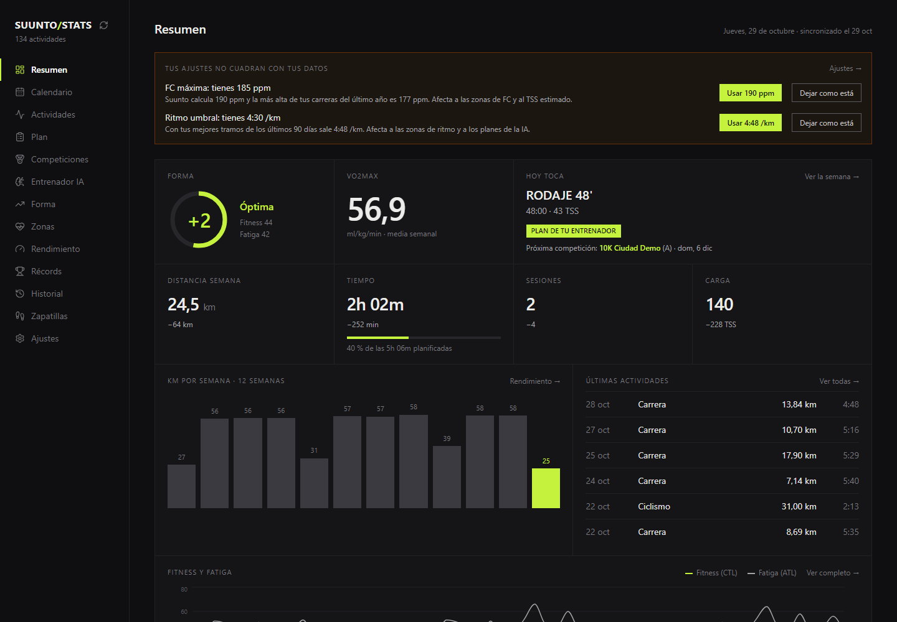
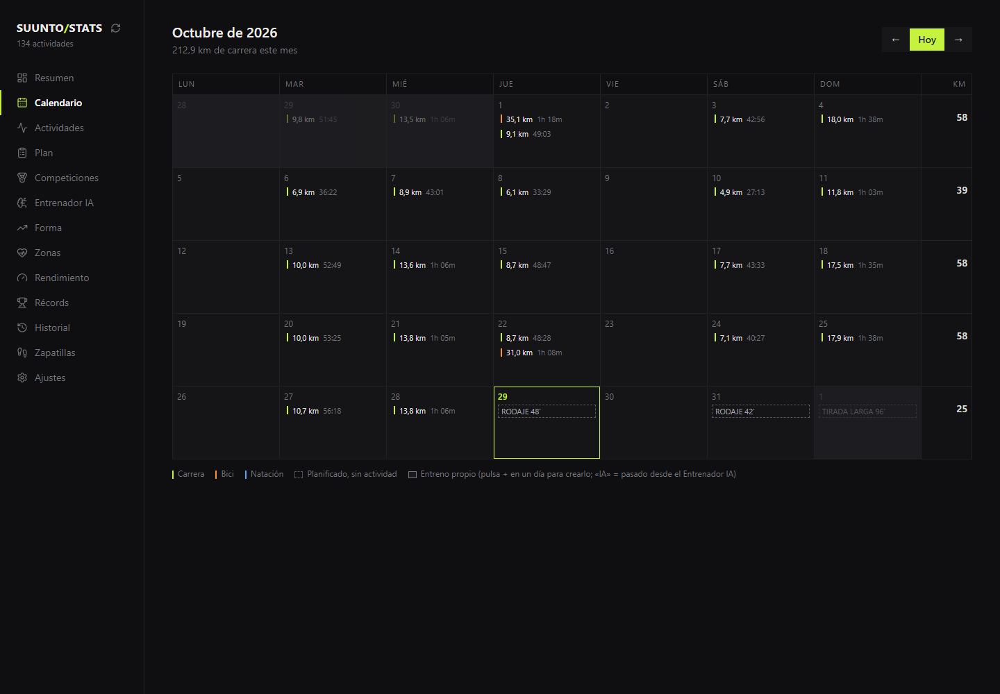
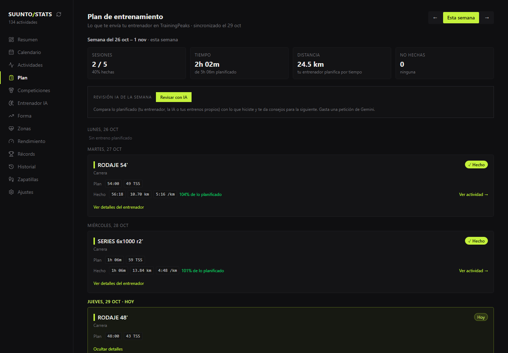
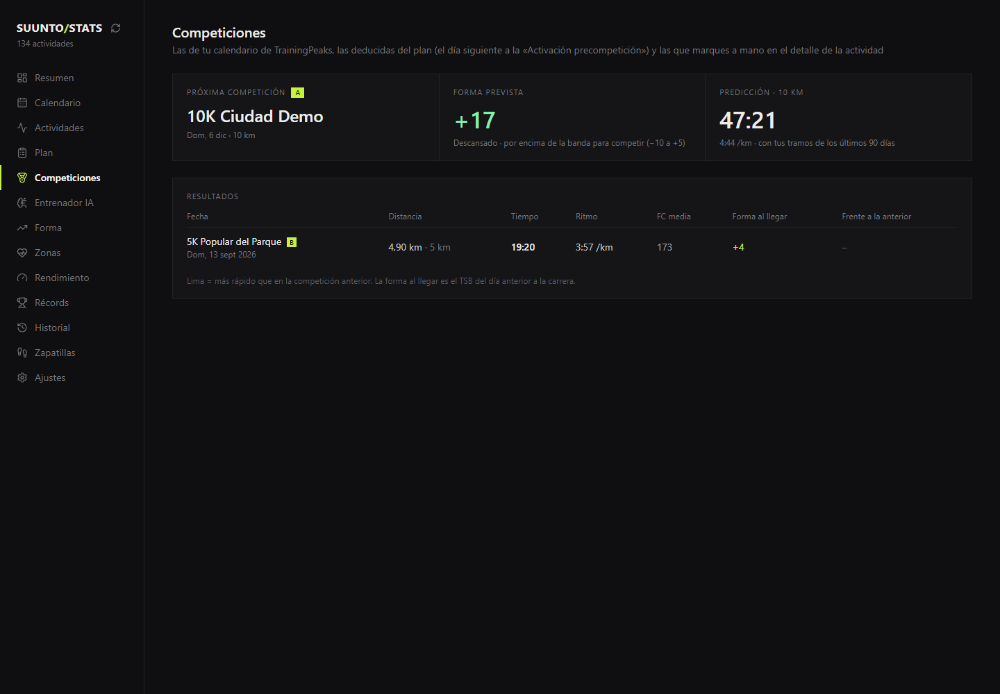

# Suunto Stats

**English** · [Español](README.es.md)

**Suunto Stats** is a free, open-source training dashboard for runners with a Suunto watch. It downloads your workouts to your own computer and shows your fitness and your **projected form** for the coming weeks, your heart rate and pace zones (with the 80/20 split), your **records** with **race time predictions**, your races, your history by year, a map of every run colored by pace and the km on your **shoes**. The **calendar** shows a month of what you did and what you have planned, and you can add your own workouts. If you have a coach, it adds their **TrainingPeaks plan** (optional) next to what you actually did. On top of that, an **AI coach** (Gemini, Claude, OpenAI or a local model) creates **weekly plans**, in your coach's style or without a coach for a 5K, 10K, half or full marathon, adds them to the calendar and reviews how each week went. It works with your Suunto account or with FIT files. No cloud and no database: your data stays with you, except the summaries you choose to send to the AI. And if you want to use it from anywhere, you can publish it on your own domain with a password and a code ([deployment guide](GUIDE_DEPLOY.md)).

> The app's interface is in **Spanish**. Section names below are given as they appear on screen, with a translation the first time.



> The screenshots come from the **demo**, with made-up data: you can try it yourself without a Suunto account (see [Try the demo](#try-the-demo-no-account-needed)).

---

## What the app does

| Section | What you get |
| --- | --- |
| **Resumen** (Dashboard) | Today's form, VO2max, «Hoy toca» (today's session), current week, km per week, latest activities and warnings (outdated settings, worn-out shoes) |
| **Calendario** (Calendar) | Month with what you did, what was planned and your races; create, edit and delete your own workouts (shown as an agenda on mobile) |
| **Actividades** (Activities) and **Detalle** (Detail) | Filterable list; for each activity, a map coloured by pace, laps, zones, best efforts and the shoes you wore |
| **Plan** | Your coach's plan from TrainingPeaks (optional) with what is done and pending, and the **AI weekly review** |
| **Competiciones** (Races) | Your races, the form you arrived with and the prediction for the next one |
| **Entrenador IA** (AI Coach) | With Gemini (free, optional; or OpenAI, Mistral, Claude, a local model with Ollama… see [Choosing the AI](#choosing-the-ai)): ask about your training and generate weeks **like your coach** or **without a coach** for a goal (5K, 10K, half, marathon or none); send them to your Calendar |
| **Forma, Zonas, Rendimiento, Récords, Historial** (Form, Zones, Performance, Records, History) | CTL/ATL/TSB with projection, 80/20, efficiency, decoupling, records with predictions and yearly totals |
| **Zapatillas** (Shoes) | Km per pair with tags (easy run, race…) and a warning as they near their limit |
| **Importar FIT** (Import FIT) | Upload `.fit` files from the browser (drag and drop); with a Suunto account they are added to it without duplicating sessions |
| **Ajustes** (Settings) | Thresholds, hints for the AI and a **backup** of what you store in the browser |

| Calendar | Plan | Races |
| --- | --- | --- |
|  |  |  |

---

## Try the demo (no account needed)

With Node.js installed (see [What you need](#what-you-need)), from the project folder:

```bash
npm install
npm run demo
```

Open the link it prints. It uses the made-up data in `demo/data/` (a fictional runner, their plan and two races) and never touches yours. To bring the dates up to today: `python3 fetch/make_demo.py` (on Windows, `py fetch\make_demo.py`).

---

## Two ways to bring in your data

| | **Route A — Automatic** | **Route B — FIT files** |
| --- | --- | --- |
| How it works | Reads your Suunto account (the same one as the phone app) | You export your workouts as `.fit` from the app and copy them to a folder |
| Convenience | One command downloads your whole history | Workouts have to be exported one by one |
| Risk | **Unofficial**: Suunto offers no API for personal use. It may stop working without notice and could go against their terms of use | None: they are your own files |
| You need | The `suuntool` tool (only to log in) | Nothing else |

Pick one. If you switch from one to the other, the activity list is rebuilt from the new source (they are not mixed). The rest of the app is identical.

First do the **common setup**, then follow only your route's section: [Route A](#route-a--automatic-suunto-account) or [Route B](#route-b--fit-files).

---

## Common setup (both routes)

### What you need

| Program | What it is for | How to check |
| --- | --- | --- |
| **Node.js** (v18 or later) | Run the web app | `node --version` |
| **Python** (v3.10 or later) | Download and prepare the data | `python3 --version` |

> **No Node.js or Python?**
>
> - Node.js: [https://nodejs.org](https://nodejs.org) → download the LTS version.
> - Python: [https://python.org/downloads](https://python.org/downloads) → usually already installed on Mac/Linux.
>
> **On Windows**, use `py` wherever it says `python3`. If PowerShell says running scripts is disabled (it happens with `npm` and the virtual environment), run once: `Set-ExecutionPolicy -Scope CurrentUser RemoteSigned`.

### 1. Get the project

Open the project folder in the terminal:

```bash
cd path/to/suunto-stats
```

### 2. Install the Python dependencies

From the project's root folder:

```bash
python3 -m pip install -r fetch/requirements.txt
```

> **If `pip` says «externally-managed-environment»** (it happens on Ubuntu/WSL and other recent distributions), create a virtual environment in the project folder and use it for every Python command:
>
> ```bash
> sudo apt install python3-venv          # Debian/Ubuntu only, if missing
> python3 -m venv .venv
> source .venv/bin/activate              # Windows (PowerShell): .venv\Scripts\Activate.ps1
> python3 -m pip install -r fetch/requirements.txt
> ```
>
> Every time you open a new terminal, run `source .venv/bin/activate` before `python3 fetch/sync.py`.

### 3. Personal options in `.env` (optional)

Without `.env` everything works with your Suunto data. You need it for the time zone, the TrainingPeaks plan or the AI Coach (Gemini). Copy the template and edit the copy:

```bash
cp .env.example .env                  # Windows (PowerShell): Copy-Item .env.example .env
```

Each option is explained in the file itself; remove the `#` from the ones you use and fill in your values. `.env` is in `.gitignore` and **is never uploaded to GitHub**: do not put keys in `.env.example`.

---

## Route A — Automatic (Suunto account)

### A1. Install suuntool

It is only used to log in to Suunto once: [github.com/tajchert/suuntool](https://github.com/tajchert/suuntool)

- Mac / Linux with Homebrew: `brew install --cask tajchert/tap/suuntool`
- With Go installed: `go install github.com/tajchert/suuntool@latest`
- Windows: there are no official binaries. Install [Go](https://go.dev/dl/) (Windows installer), open a **new** PowerShell and run `go install github.com/tajchert/suuntool@latest`. It ends up in `%USERPROFILE%\go\bin\suuntool.exe`; add that folder to PATH or run it with the full path. Alternative: WSL (Ubuntu). Use PowerShell or Windows Terminal (in Git Bash the login may fail with «stdin is not a TTY»).

Check it with `suuntool version`.

### A2. Log in to Suunto (first time only)

```bash
suuntool login --email you@example.com
```

It will ask for your Suunto password (the one for the phone app). **No password is stored in this project**: `suuntool` only keeps a session key in `~/.config/suuntool/session.json`.

Check that everything is fine:

```bash
suuntool doctor
```

> `suuntool` only supports email + password. If you sign in to the Suunto app with Facebook or another social login, first create a Suunto password (in the app: Settings → Account → Change password; you get a link by email). It has not been confirmed that this is enough for accounts created with a social login; if it does not work, use [Route B](#route-b--fit-files).

### A3. Download your activities

From the project's root folder (for a first test, only the 20 most recent):

```bash
python3 fetch/sync.py --limit 20
```

**What this command does:**

- Reads the list of your Suunto workouts
- Downloads each one's detail (HR zones, laps, GPS route)
- Saves everything in `public/data/` (JSON files)

The first time it may take **several minutes** if you have many activities. You will see the progress in the terminal.

**Useful options:**

```bash
# Whole history
python3 fetch/sync.py

# Only activities since a date
python3 fetch/sync.py --since 2024-01-01

# Faster, without GPS route or laps
python3 fetch/sync.py --no-gpx

# Download again what is already saved
python3 fetch/sync.py --force
```

> **Important:** run `python3 fetch/sync.py` again whenever you want to add new workouts. Activities already downloaded are not requested from Suunto again.
>
> **FIT files too:** any `.fit` in `fetch/fit/` (for example from another watch, or uploaded from **Importar FIT**) is added to your Suunto activities; sessions already in Suunto are detected (start within 2 min and similar duration) and not repeated. Use `--no-fit` to skip them.

### A4. Check that the data is correct (optional)

```bash
python3 fetch/validate_output.py
```

It should end with `0 errores` (0 errors).

### A5. Install the web app dependencies

In the project's root folder:

```bash
npm install
```

You only need to do this **once** (or when the project's dependencies change).

### A6. Open the app

```bash
npm run dev
```

You will see something like:

```
  ➜  Local:   http://localhost:5173/
```

Open that link in your browser (Chrome, Firefox, Safari…). To **close** the app, go back to the terminal and press `Ctrl + C`.

### Route A quick reference (once you have done it)

```bash
# 1. Sync new Suunto data
python3 fetch/sync.py

# 1b. (Optional) Your coach's plan from TrainingPeaks — see GUIDE_TRAININGPEAKS.md
python3 fetch/tp_sync.py

# 2. Start the app
npm run dev
```

Then open [http://localhost:5173](http://localhost:5173) in your browser.

`.\actualizar.ps1` (Windows) or `./actualizar.sh` (Mac/Linux) does steps 1 and 1b at once and validates the data. With the app open (`npm run dev`) you can also update with the **refresh button** next to SUUNTO/STATS, at the top of the menu.

---

## Route B — FIT files

### B1. Export your workouts

1. In the Suunto app (phone): Calendar → choose the workout → three-dot menu (top right) → **export as FIT**. Send it to your computer.
2. Copy the `.fit` files to the `fetch/fit/` folder (create it if it does not exist), or upload them later from the app's **Importar FIT** (Import FIT) page and press «Procesar» (process).

> **Lots of workouts?** Exporting them one by one is slow. If you live in the EU, the Data Act gives you the right to ask Suunto for your data for free and in formats such as FIT, GPX or JSON (through the app, Sports Tracker or by writing to Suunto; see their [official notice](https://www.suunto.com/legal-pages/suunto-eu-data-act-notice/)). This project reads `.fit` files.

### B2. Read the files

From the project's root folder:

```bash
python3 fetch/sync.py --source fit
```

Optional: in `.env` you can set `MAX_HR=190` (your max HR) so the HR zones are calculated with it.

### B3. Check that the data is correct (optional)

```bash
python3 fetch/validate_output.py
```

It should end with `0 errores` (0 errors).

### B4. Install the web app dependencies

In the project's root folder:

```bash
npm install
```

You only need to do this **once** (or when the project's dependencies change).

### B5. Open the app

```bash
npm run dev
```

Open the link it prints in your browser (usually [http://localhost:5173](http://localhost:5173)). To **close** the app, go back to the terminal and press `Ctrl + C`.

### Route B quick reference (once you have done it)

```bash
# 1. Copy the new .fit files to fetch/fit/ and read them
python3 fetch/sync.py --source fit

# 1b. (Optional) Your coach's plan from TrainingPeaks — see GUIDE_TRAININGPEAKS.md
python3 fetch/tp_sync.py

# 2. Start the app
npm run dev
```

> The app's refresh button, `.\actualizar.ps1` and `./actualizar.sh` use Route A (Suunto account); with FIT files, update with the commands above.

---

## Settings inside the app

In the side menu, open **Ajustes** (Settings) to configure:

- Max HR (when the sync finishes it tells you the one your Suunto watch has)
- Threshold HR and pace (running), with an estimate from your best efforts
- FTP (cycling)
- Hints for the AI Coach: «my wrist HR is not reliable» and «I record the warm-up separately»
- Backup: export and import everything the app stores in your browser

These values are stored in your browser and affect the zone, TSS and fitness calculations. If they do not match your data, the Dashboard warns you.

---

## Choosing the AI

The AI Coach uses **Gemini** by default (`GEMINI_API_KEY` in `.env`; free key from Google AI Studio). To use another one, set `AI_PROVIDER` in `.env` (examples in `.env.example`):

| `AI_PROVIDER` | Works with | What to set |
| --- | --- | --- |
| `gemini` (default) | Google Gemini | `GEMINI_API_KEY`, optional `GEMINI_MODEL` |
| `openai` | Any service with the OpenAI format: OpenAI, Mistral, Groq, DeepSeek, OpenRouter… or a model on your own computer with **Ollama** / **LM Studio** (no key, your data never leaves your machine) | `AI_BASE_URL`, `AI_MODEL`, `AI_API_KEY` (not needed for localhost) |
| `anthropic` | Claude | `AI_API_KEY` (from console.anthropic.com), optional `AI_MODEL` (default `claude-opus-5-5`) |

Keys stay on the app's server and never reach the browser. No restart is needed: the app reads `.env` on every request.

---

## Publishing it on your own domain

By default the app only opens on the computer running it, with no login. To open it from anywhere, deploy it on a server behind [Authelia](https://www.authelia.com) (password + code from an authenticator app) by setting `AUTH_MODE=authelia`. Step-by-step guide for Dokploy: [GUIDE_DEPLOY.md](GUIDE_DEPLOY.md).

## Which Suunto data you will see

| Data | Detail |
| --- | --- |
| Distance, duration, elevation, HR, calories | Always |
| TSS | The one Suunto calculates; if missing, the app estimates it from HR |
| VO2max | Suunto only calculates it on runs and walks, so there will be few readings |
| Training Effect | The aerobic one is shown (Suunto's PTE, 1-5 scale). The anaerobic one is not in Suunto's data |
| HR zones | Your watch's zones (real time in each zone) |
| Laps | Your watch's laps; if there are none, automatic ones are calculated (every 1 km, or 5 km on the bike) |
| SWOLF / strokes | Not in the data |

---

## Common problems

### "ERROR: No hay sesión de Suunto" — no Suunto session (Route A)

You have not logged in yet. Run `suuntool login --email you@example.com` and sync again.

### "Sesión de Suunto no válida o caducada" — invalid or expired session (Route A)

The session key is no longer valid. Run `suuntool login --email you@example.com` again.

### It asks for the login and the password is right (Route A)

Try `suuntool doctor`. If the login fails but the password is correct, Suunto may have changed something in its app and `suuntool` may need updating (`brew upgrade --cask suuntool` or `go install github.com/tajchert/suuntool@latest`).

### Activities are missing, or the route / laps are empty (Route A)

Run `python3 fetch/sync.py --dump latest`. It saves in `fetch/debug/` what Suunto returns for your latest workout; with that you can see which field changed. To ask for help, share **only** the `*.redacted.json` file (without coordinates or user): the other files in that folder contain your GPS route.

### Times are shifted

Set your time zone in `.env`: `SUUNTO_TIMEZONE=Europe/Madrid`.

### "No hay ficheros .fit" — no .fit files (Route B)

Copy your `.fit` files to `fetch/fit/` (Route B) or run the sync without `--source fit` (Route A).

### "No se encontró /data/activities.json" in the app

You have not synced any data yet. Run first:

```bash
python3 fetch/sync.py
```

### The terminal says `node` or `npm` do not exist

Install Node.js from [nodejs.org](https://nodejs.org) and open the terminal again.

### The sync is very slow (Route A)

That is normal: there is a pause between requests so as not to overload Suunto's server. For a quick test use `--limit 20` or `--no-gpx`. If you see 429 errors, raise the pause with `SUUNTO_PAUSE=1.5` in `.env`.

### Port 5173 already in use

Close other terminal windows where `npm run dev` is running, or Vite will offer another port (for example 5174).

---

## Extra commands (optional)

| Command | Description |
| --- | --- |
| `npm run build` | Builds an optimised version in the `dist/` folder |
| `npm run preview` | Previews the production build (after `build`) |
| `npm run lint` | Checks the code with the linter |
| `npm test` | Runs the tests (vitest) |
| `npm run demo` | Opens the app with the made-up data in `demo/data/` |
| `python3 fetch/make_demo.py` | Regenerates the demo with dates up to today |
| `python3 fetch/validate_output.py` | Checks that the downloaded data has the right format |

---

## Project structure (reference)

```
suunto-stats/
├── .env                      ← Personal options (optional, do not share)
├── actualizar.ps1 / .sh      ← Updates everything at once (Windows / Mac-Linux)
├── demo/data/                ← Made-up data for `npm run demo`
├── server/                   ← Vite server routes (access control, AI, refresh button, FIT upload)
├── deploy/authelia/          ← Authelia configuration for a public deployment
├── fetch/
│   ├── sync.py               ← Script that downloads the data
│   ├── suunto_client.py      ← Route A: reads your Suunto account
│   ├── fit_source.py         ← Route B: reads FIT files
│   ├── normalizer.py         ← Converts the data to the app's format
│   ├── validate_output.py    ← Checks the data format
│   ├── tp_sync.py            ← (Optional) TrainingPeaks plan
│   ├── make_demo.py          ← Generates the demo
│   ├── requirements.txt      ← Python dependencies
│   └── fit/                  ← (Route B) your .fit files
├── public/data/              ← Downloaded data (JSON)
└── src/                      ← Web app code (React)
```

---

## Privacy and what NOT to upload to GitHub

These files contain personal data or credentials. `.gitignore` already excludes them, but it is worth knowing them:

| File / folder | What it contains | Risk |
| --- | --- | --- |
| `.env` | Personal options, TrainingPeaks cookie, Gemini key (and the Suunto session key if you put it there) | Access to your accounts |
| `~/.config/suuntool/session.json` (in your home) | Suunto session key | Access to your account without a password |
| `public/data/` | Activities, statistics and GPS routes | Exact location, health, habits |
| `dist/data/` | Copy of the data when running `npm run build` | Same as above |
| `fetch/debug/` and `fetch/fit/` | Raw responses and FIT files | Full GPS routes |

**Sensitive data inside the JSON files:**

- GPS coordinates of every workout (they can reveal where you live or train)
- HR, VO2max, calories, paces and time patterns

**Safe to publish:**

- `.env.example` (example values only)
- All the code in `src/` and `fetch/` (except the `fetch/debug/` and `fetch/fit/` folders)

**Before running `git push`**, check that no data slips in:

```bash
git status
```

Neither `.env` nor files inside `public/data/` should appear. If you ever added them by mistake:

```bash
git rm -r --cached public/data/
git rm --cached .env
```

Then commit the removal. If you already uploaded them to GitHub, **log out of Suunto** (`suuntool logout`), change your Suunto password and consider deleting the repository history.

---

## Contributing

Bug reports, ideas and pull requests are welcome. Read [CONTRIBUTING.md](CONTRIBUTING.md) first: how to set up the project with the demo data, the checks to run and, above all, how to report a problem without sharing your personal data.

---

## Disclaimer

This project is not affiliated with Suunto. Route A uses a service that Suunto has not published as an API: it may change or stop working at any time, and using it might not comply with Suunto's terms. Use it only with your own account and in moderation. If you prefer to avoid that risk, use Route B.

---

## License

[MIT](LICENSE): you may use, copy and modify the code freely, keeping the copyright notice.
